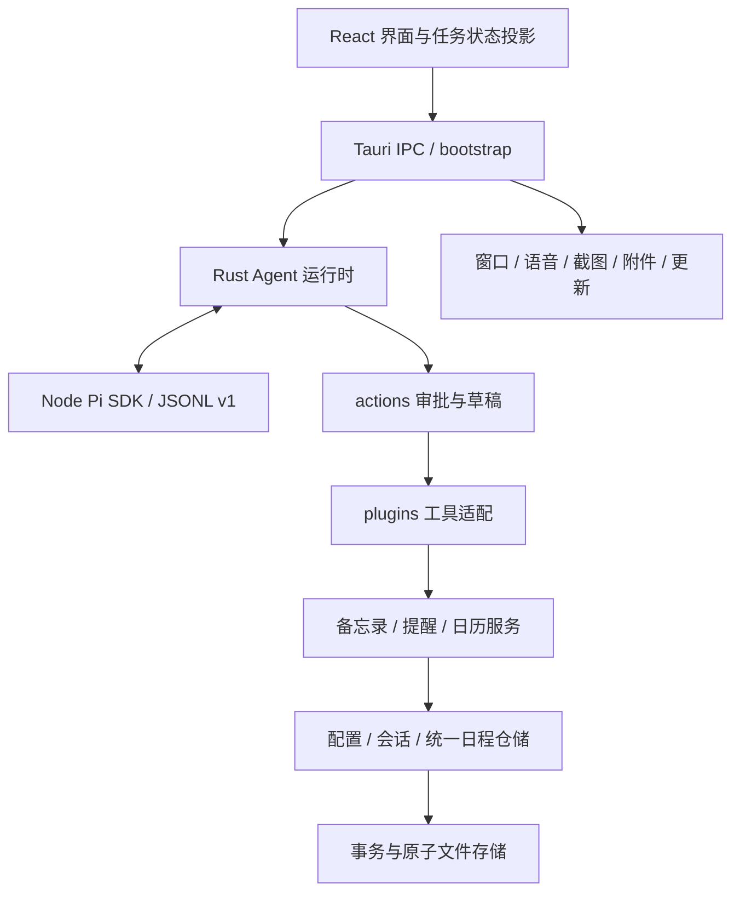

# Piko 当前运行边界

本轮渐进重构已完成。`lib.rs` 仅声明模块并转发应用入口；`bootstrap.rs` 负责 Tauri 插件、运行状态、窗口、后台任务、命令注册及退出清理。业务代码通过显式依赖引用所属模块，不再借根模块传递类型、工具函数或服务。

## 运行结构

## 模块归属

| 边界 | 当前职责 |
| --- | --- |
| `app_settings.rs`、`settings.rs`、`settings_commands.rs` | 配置 DTO/默认值、持久化与配置 IPC；凭据由 `credentials.rs` 独立处理 |
| `providers.rs`、`providers_commands.rs` | 供应商分类、认证、URL、请求及流式增量解析、模型查询 |
| `agent.rs` 及其协议/快照/日志模块 | SDK 任务运行、审批、取消、检查点和任务恢复 |
| `chat.rs`、`chat_stream.rs` | 兼容聊天请求、消息构造及流式响应 |
| `runtime_types.rs` | 聊天运行状态、跨模块事件及临时上下文类型 |
| `plugins/` | 注册表、内置业务适配、声明式/WASI 插件、供应商工具桥接及查询命令 |
| `actions/` | 草稿预览、一次消费队列、选择校验、确认/拒绝及执行编排 |
| `memos/` | 备忘录 DTO、分类、摘要、存储、CRUD 与命令 |
| `reminder_service/`、`reminder_schedule.rs` | 提醒视图、检查点约束、CRUD、到期通知和重复时间计算 |
| `calendar_service/` | 日历视图、检查点、冲突、批量操作、ICS、到期通知及命令 |
| `schedule.rs`、`schedule/repository.rs`、`schedule/commands.rs` | 统一日程模型/转换/迁移算法、应用仓储及时间线命令 |
| `chat_session.rs`、`chat_session/repository.rs`、`chat_session/commands.rs` | 会话模型/分组/迁移算法、历史兼容视图、仓储及会话命令 |
| `rhythm.rs` | 专注计时、工作节奏、记录、静默时间与休息提醒 |
| `favorites.rs` | HTML 收藏、持久化、去重与 Soul 输出生命周期更新 |
| `desktop.rs` | 桌宠/气泡/面板窗口、几何位置、托盘、菜单和全局快捷键 |
| `screen_capture.rs`、`attachments.rs` | 截图权限/区域/预览、文本附件和生成文件保存 |
| `speech.rs` | 本地朗读、语音模型下载、音频解析及转写 |
| `app_updates.rs`、`companion.rs` | 更新查询/下载、陪伴回复生成 |
| `ambient.rs`、`awareness_commands.rs` | 空闲/前台感知 watcher、环境事件与感知设置命令 |
| `data_commands.rs`、`sync/` | 清理/导入/导出命令、备份与系统日历同步 |
| `common.rs` | 时间戳、工具时间解析、文本截断及 data URL 解析 |
| `architecture_tests.rs` | 跨模块契约与集成测试；领域测试保留在对应模块 |

已移除没有接入编译和代码引用的 `calendar.rs`、`capture.rs`、`reminders.rs`、`updates.rs`、`tts.rs`、`constants.rs` 旧副本。历史验证记录描述的是对应阶段当时的状态；当前归属以本文件及编译模块图为准。

## 存储与迁移约束

- `schedule-items.json` 是提醒/日历的唯一运行存储。领域服务通过视图和合并写入共享仓储，修改一种记录不扰动另一种记录。
- `chat-sessions.json` 是聊天历史的唯一写入口。逐轮历史通过会话视图提供，保留原 entry ID、分组规则和最近 200 个会话的保留策略。
- 两个仓储均保留迁移版本、备份和损坏处理：读路径可在迁移失败后只读旧文件，写路径严格传播错误。迁移不会把损坏文件当作空列表写入并标记成功。
- 存储事务、持久化后的更新事件、日历同步删除墓碑、删除历史时的 Soul 来源清理顺序均保持原行为。
- 配置 UI 读取继续使用既有默认值回退；导入读取使用严格解析，凭据不混入普通配置导出。

## 工具、审批与恢复

草稿生成只创建预览，不执行业务工具。`actions::store` 封装锁，使用 `get` 读取副本、`take` 原子消费、`discard` 仅清理指定任务的草稿。共享批量选择校验仍用于授权准备与最终执行；业务服务保留检查点 ID、幂等返回、防覆盖和禁止自动重建约束。

前端任务 reducer 只接收对应 requestId 的事件，终态后拒绝进度更新，审批和工具事件按 ID 去重。Rust 以 `RunningTask` 为运行事实，`agent_snapshot.rs` 提供内存快照；前端先订阅事件、再读取快照，用 `eventSequence` 过滤重放和合并缓冲。快照恢复只更新界面，不执行工具。

快照保留最近 64 条工具调用。隐藏/卸载窗口不自动取消任务，显式停止仍取消。应用重启、未知工具结果、安全续跑和审批策略保持原行为，本轮不新增跨重启自动执行。

## 协议与模型网络

Rust/Node 使用带 `protocolVersion: 1` 的私有 JSONL 协议，校验 start、steer、approval、app-result、cancel 等消息。Sidecar 的协议辅助文件纳入打包依赖闭包，Node 行为有独立测试。

Rust `providers` 服务于兼容聊天及后台模型请求，Node/Pi SDK 服务于 Agent 任务。两条路径分别保留协议与生命周期；本轮未将它们强制合并。认证测试使用显式测试密钥，不触碰用户凭据。兼容聊天 `chat_start/chat_cancel` 继续保留。

## 验证与约束入口

- `npm run check:architecture`：约束根模块只暴露入口、模块显式依赖、IPC 使用所属模块路径及名称唯一性。
- `cargo test --manifest-path src-tauri/Cargo.toml --lib`：领域、存储、迁移、协议与运行契约测试。
- `cargo check --manifest-path src-tauri/Cargo.toml --all-targets`：库、测试和应用目标的编译检查。
- `npm test`、`npm run test:agent`、`npm run build`：前端、Node Agent 和前端生产构建。

源码迁移逐项核对，最终阶段的 153 个定义与启动流程保持逻辑一致，165 个 IPC 名称和注册顺序保持不变。未新增依赖、用户数据迁移或权限流程；原生窗口、系统通知、语音硬件、真实日历同步及外部模型服务仍需在交互环境进行验证。
